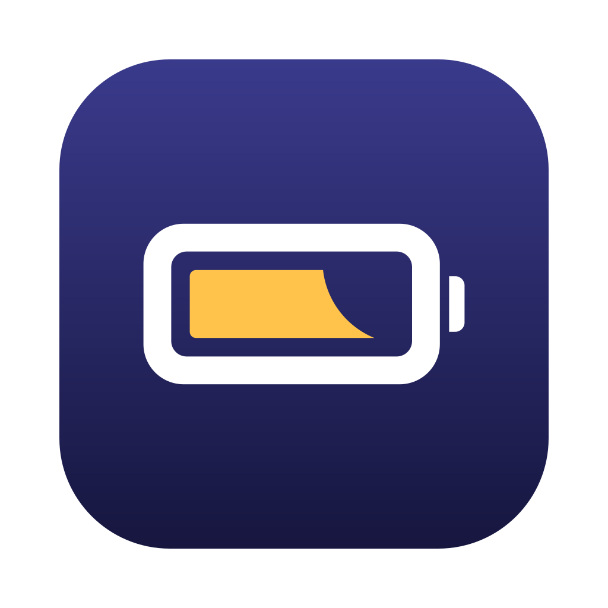
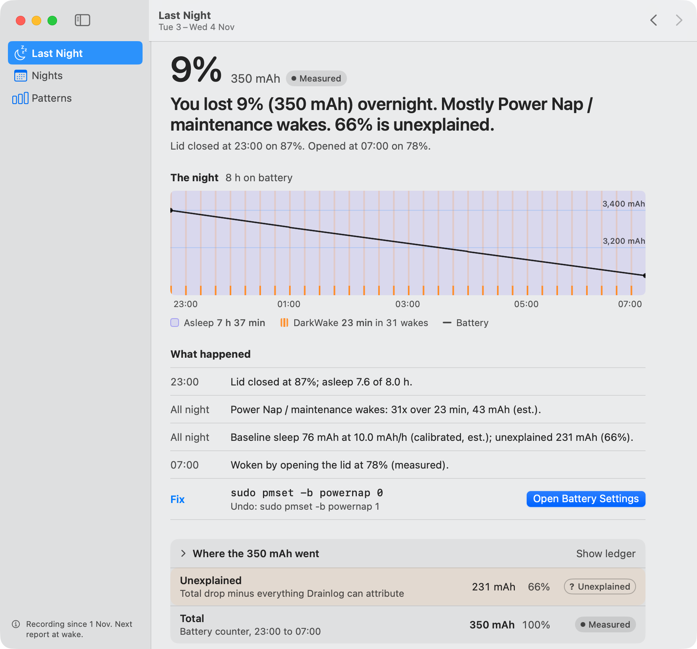

<p align="center"></p>

<h1 align="center">Drainlog</h1>

<p align="center"><a href="https://github.com/jelwingeuan/Drainlog/actions/workflows/test.yml"></a></p>

Answers one question: **why did my Mac's battery die overnight?**

Drainlog reads macOS's own power records (`pmset -g log`, `pmset -g assertions`, the `com.apple.powerd` log, and battery counters from IOKit). It builds a ledger of each night: time asleep, in DarkWake and awake, and how much charge each part cost. The morning report is a short incident timeline: what happened, why, and one fix.

## Honest numbers

macOS reports no per-app energy use while the lid is closed. Drainlog therefore labels every number:

- **Measured**: battery charge in mAh, read at sleep and at wake.
- **Estimated**: how that loss splits between baseline sleep drain and each wake, priced against your Mac's own measured baseline.
- **Unexplained**: whatever is left over. It is always shown, never hidden.

No root required.



*Morning report, shown with demo data built from the test fixtures.*

## Status

- **Stage 1 (explain last night)**: built. This covers the battery agent, the ledger, the morning report window, the menu bar popover and the notification. It's waiting on real battery nights to measure the baseline and to run the 10-night judge in [`judge/`](judge/README.md).
- **Stage 2 (patterns across weeks, one recommended fix)**: not started.
- **Stage 3 (warning at lid close)**: not started.

There is no release yet. Build it from source as shown below.

Tested on Apple silicon (M1). Intel builds compile but are **untested**: Intel Macs name battery keys and wake reasons differently, and handle standby and hibernate differently.

## Build from source

Needs macOS 14 or later, Xcode (Swift 6.2+) and Rust ([rustup](https://rustup.rs)) with the `x86_64-apple-darwin` target.

```bash
scripts/bundle.sh
open build/Drainlog.app
```

On first launch, Drainlog registers its background agent (`drainlogd`) under System Settings › General › Login Items. The data stays on your Mac, in `~/Library/Application Support/Drainlog/drainlog.db`.

Tests:

```bash
(cd core && cargo test)
(cd app && swift test)
```

## Security

See [SECURITY.md](SECURITY.md). Report vulnerabilities privately through GitHub's "Report a vulnerability" button.

## License

[MIT](LICENSE)
